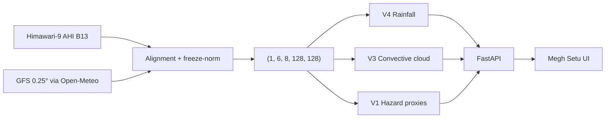

<div align="center">

# Megh Setu (मेघ सेतु)

**AI-Powered Convective Weather Nowcasting & Severe Weather Decision Support**

Smart India Hackathon · Problem Statement **SIH26084**

[](https://frontend-gamma-six-53.vercel.app/)
[](https://fastapi.tiangolo.com)
[](https://pytorch.org)
[](https://react.dev)
[](https://www.typescriptlang.org)

[Live Dashboard](https://frontend-gamma-six-53.vercel.app/) · [GitHub](https://github.com/rawatrishab007/Nowcast) · [API Docs (local)](http://localhost:8000/docs)

</div>

🌐 **Live Vercel Deployment**: [https://frontend-gamma-six-53.vercel.app](https://frontend-gamma-six-53.vercel.app)

[](https://frontend-gamma-six-53.vercel.app)
[](https://vitejs.dev/)
[](https://react.dev/)
[](https://python.org)
[](https://fastapi.tiangolo.com)

---

## 🚀 Live Deployment & Architecture

| Component | Platform | Status | URL / Access |
| :--- | :--- | :--- | :--- |
| **Frontend Web App** | **Vercel** | 🟢 **Live** | [https://frontend-gamma-six-53.vercel.app](https://frontend-gamma-six-53.vercel.app) |
| **Backend API Services** | **AWS (EC2 / ECS)** | 🟡 *Targeted for AWS deployment* | Configurable via `VITE_API_BASE_URL` |

---

## Contents

- [Problem](#problem)
- [What Megh Setu does](#what-megh-setu-does)
- [Live deployment](#live-deployment)
- [Architecture](#architecture)
- [Models](#models)
- [Input tensor](#input-tensor)
- [Frontend](#frontend)
- [API](#api)
- [Repository layout](#repository-layout)
- [Quickstart](#quickstart)
- [Docker](#docker)
- [Environment](#environment)
- [Disclaimer](#disclaimer)

---

## Problem

Severe convective weather — thunderstorms, lightning, hail, cloudbursts, and downbursts — develops on **sub-hourly** timescales. Lightning alone kills thousands of people in India every year.

Global NWP systems such as GFS are essential for synoptic context, but they typically:

- update on multi-hour cycles
- assimilate observations with latency
- cannot fully resolve local convective initiation at 0–2 hour range

**SIH26084** asks for a short-range nowcasting and decision-support system that can fill that 0–120 minute gap.

---

## What Megh Setu does

Megh Setu is an operational-style prototype for the Indian subcontinent:

| | |
| :--- | :--- |
| **Domain** | 8°N–38°N, 68°E–98°E |
| **Cadence** | 6 frames, 10 minutes apart (`t−50m` … `t0`) |
| **Grid** | 128 × 128 (~60 km cell size over the full domain) |
| **Lead times** | +30, +60, +90, +120 minutes |
| **Inputs** | Himawari-9 AHI Band 13 IR + GFS 0.25° fields (via Open-Meteo) |
| **Models** | V4 rainfall · V3 convective cloud · V1 multi-hazard proxies |

It produces:

1. **Rain rate** and rain probability (V4, experimental)
2. **Cold-cloud / deep-convection proxy** \(P(\text{future B13} < 235\,\text{K})\) (V3)
3. **Hazard risk scores** for lightning, thunderstorm, hail, cloudburst, and downburst (V1)
4. **Rule-based advisories**, map replay, station/probe inspection, and a print-ready Situation Report

All operator-facing clocks are shown in **IST (UTC+05:30)**.

---

## Live deployment

| Component | Platform | Status | Access |
| :--- | :--- | :---: | :--- |
| Frontend dashboard | Vercel | Live | [frontend-gamma-six-53.vercel.app](https://frontend-gamma-six-53.vercel.app/) |
| Backend API | Local / AWS-targeted | Configurable | `VITE_API_BASE_URL` (default local: `http://localhost:8000/api`) |
| Swagger | FastAPI | Local | [http://localhost:8000/docs](http://localhost:8000/docs) |
| Health | FastAPI | Local | [http://localhost:8000/api/health](http://localhost:8000/api/health) |
| Pipeline telemetry | FastAPI | Local | [http://localhost:8000/api/health/pipeline](http://localhost:8000/api/health/pipeline) |

The Vercel app is the operations UI. Full live nowcasts require a running FastAPI backend with model checkpoints and network access to Himawari-9 S3 + Open-Meteo GFS.

---

## Architecture

```
Himawari-9 AHI Band 13 (10.4 µm IR)     NOAA GFS 0.25° (Open-Meteo)
        B13 brightness temperature        t2m, d2m, u10, v10, CAPE, CIN, tp
                         \                      /
                          \                    /
                     Spatiotemporal alignment
                   6 frames @ 10-min cadence
                              |
                 Tensor  (1, 6, 8, 128, 128)
                              |
              +---------------+---------------+
              |               |               |
           V4 Rain         V3 Cloud        V1 Hazards
           mm/hr, P(rain)  P(B13 < 235 K)  5 risk scores
              |               |               |
              +---------------+---------------+
                              |
                    FastAPI  /api/v1/nowcast
                              |
                 Megh Setu dashboard (React 19 + Vite)
                 Map · Replay · Alerts · SitRep · Health
```



**Stack**

| Layer | Technology |
| :--- | :--- |
| Frontend | React 19, TypeScript, Vite 7, Tailwind CDN, Leaflet, Recharts |
| Backend | Python 3.10+, FastAPI, Pydantic v2, Uvicorn |
| Inference | PyTorch 2.x (CUDA / Apple MPS / CPU) |
| Satellite | AWS Open Data `noaa-himawari9` (public, no credentials) |
| NWP | Open-Meteo operational GFS 0.25° |

---

## Models

Shared backbone: **Conv2D encoder → ConvLSTM → Conv2D decoder → four horizon heads**.

### V4 — Rainfall (`SIHV4RainfallNowcast`)

| | |
| :--- | :--- |
| Role | Experimental rain rate + occurrence nowcast |
| Parameters | 93,208 |
| Hidden channels | 32 |
| Heads | `rain` (mm/hr), `rain_probability` \([0,1]\) |
| Checkpoint | `sih_v4_rain_corrected_best.pth` |

Calibrated against satellite precipitation benchmarks (IMERG-style). Treat as research output, not an official QPF.

### V3 — Convective cloud (`SIHV3Nowcast`)

| | |
| :--- | :--- |
| Role | Deep-convection / cold-cloud proxy |
| Parameters | 200,996 |
| Hidden channels | 48 |
| Target | \(P(\text{future B13} < 235\,\text{K})\) |
| Checkpoint | `sih_v3_best.pth` |

### V1 — Severe weather (`SIHMultiHazardNowcast`)

| | |
| :--- | :--- |
| Role | Multi-hazard proxy assessment |
| Parameters | 93,548 |
| Hidden channels | 32 |
| Outputs | Lightning, thunderstorm, hail, cloudburst, downburst scores \([0,1]\) |
| Checkpoint | `sih_multihazard_v1_best.pth` |

V1 scores are **physics-informed risk indices**, not calibrated event probabilities and not IMD warnings.

---

## Input tensor

Every inference pass uses a frozen training normalization:

\[
x_{\mathrm{norm}} = (x - \mu) / \sigma
\]

**Shape:** `(batch=1, time=6, channels=8, height=128, width=128)`

| Idx | Channel | Live source | Meaning | Unit | μ | σ |
| :---: | :---: | :--- | :--- | :---: | ---: | ---: |
| 0 | `B13` | Himawari-9 AHI | 10.4 µm IR brightness temperature | K | 258.9513 | 12.8962 |
| 1 | `t2m` | GFS | 2 m air temperature | °C | 24.3378 | 11.2362 |
| 2 | `d2m` | GFS | 2 m dewpoint | °C | 17.6339 | 11.1469 |
| 3 | `u10` | GFS | 10 m zonal wind | m/s | 2.7062 | 2.8719 |
| 4 | `v10` | GFS | 10 m meridional wind | m/s | 1.7265 | 2.7279 |
| 5 | `cape` | GFS | Convective available potential energy | J/kg | 720.3760 | 851.9800 |
| 6 | `cin` | GFS | Convective inhibition | J/kg | 90.9589 | 145.4562 |
| 7 | `tp` | GFS | Total precipitation accumulation | m | 0.0002 | 0.0007 |

Channel order is strict. Do not permute or re-normalize per request.

---

## Frontend

High-contrast operations UI (`#181818` background, `#2A2A2A` cards, `#60A5FA` headings). Red is reserved for alerts and errors.

| Surface | Purpose |
| :--- | :--- |
| **Home** | Dashboard: map, metrics, alerts, trends, health |
| **Reports** | White, print-ready meteorological SitRep |
| Map | Leaflet colormap layers with bilinear interpolation |
| Replay | Scrub +30 / +60 / +90 / +120 min |
| Inspector | Stations (Dehradun default) or click-to-probe with reverse geocode |
| Alerts | Threshold engine → Advisory / Watch / Warning |
| Health | Model load, ingestion freshness, inference latency |
| Export | JSON / CSV of the current nowcast at the selected point |

---

## API

Base URL: `http://localhost:8000` · OpenAPI: `/docs` · ReDoc: `/redoc`

### Predictions

| Method | Path | What it does |
| :--- | :--- | :--- |
| `GET`/`POST` | `/api/v1/nowcast` | Unified V1 + V3 + V4 on live data |
| `GET`/`POST` | `/api/nowcast` | Same as above (alias) |
| `GET`/`POST` | `/api/predict/live` | V3-only live convective nowcast |
| `GET`/`POST` | `/api/predict/demo` | Stored validation tensor (404 if missing — no fake data) |
| `POST` | `/api/predict` | Custom 6-frame, 8-channel JSON tensor |

```bash
curl -s http://localhost:8000/api/v1/nowcast | jq '.status, .data_mode, .base_time, .models'
```

<details>
<summary>Sample <code>/api/v1/nowcast</code> payload (truncated)</summary>

```json
{
  "status": "success",
  "data_mode": "live",
  "base_time": "2026-10-12T03:50:00+00:00",
  "forecast_horizons": [30, 60, 90, 120],
  "grid_metadata": {
    "lat_min": 8.0, "lat_max": 38.0,
    "lon_min": 68.0, "lon_max": 98.0,
    "height": 128, "width": 128
  },
  "models": {
    "rain": "SIHV4RainfallNowcast (V4)",
    "convective_cloud": "SIHV3Nowcast (V3)",
    "hazards": "V1 Severe Weather Hazard Assessment"
  },
  "horizons": {
    "30": {
      "horizon_minutes": 30,
      "rain": { "unit": "mm/hr", "min": 0.0, "max": 2.15, "mean": 0.53, "map": [[]] },
      "thunderstorm": { "unit": "risk_score [0,1]", "min": 0.10, "max": 0.58, "mean": 0.13, "map": [[]] }
    }
  }
}
```

</details>

### Health & metadata

| Method | Path | What it does |
| :--- | :--- | :--- |
| `GET` | `/` | Service discovery |
| `GET` | `/api/health` | Device (`cpu`/`cuda`/`mps`) and V1/V3/V4 load flags |
| `GET` | `/api/health/pipeline` | Himawari S3, GFS, alignment, freshness, latency |
| `GET` | `/api/model-info` | Architecture, channels, horizons, target semantics |

Live ingestion failures are explicit HTTP errors (`HIMAWARI_DATA_UNAVAILABLE`, `GFS_DATA_UNAVAILABLE`, `TEMPORAL_ALIGNMENT_FAILED`). There is no silent synthetic fallback in operational mode.

---

## Repository layout

```
Nowcast/
├── ai_ml/models/          # V1 / V3 / V4 definitions (+ checkpoints if present)
├── backend/               # FastAPI inference service
│   ├── data_providers/    # Himawari-9 S3 + GFS / Open-Meteo
│   ├── models/            # Runtime .pth drop-in folder
│   ├── routes/            # health.py, prediction.py
│   ├── utils/             # Normalization & tensor checks
│   ├── config.py          # Channels, domain, freeze-norm stats
│   ├── inference.py       # Unified forward pass
│   ├── model_loader.py    # ConvLSTM classes + checkpoint load
│   ├── physics.py         # Thermodynamic / hazard proxies
│   ├── schemas.py         # Pydantic contracts
│   └── requirements.txt
├── frontend/              # React 19 + Vite dashboard
│   └── src/
│       ├── components/    # Map, alerts, SitRep, health, charts
│       ├── services/api.ts
│       ├── types/
│       └── utils/         # alert engine, geocoding, IST, export
├── docker-compose.yml
├── start.sh               # Local backend + frontend launcher
└── README.md
```

`.pth` weights are gitignored. Place them at one of the loader paths, for example:

```
backend/models/sih_v3_best.pth
ai_ml/models/v4/sih_v4_rain_corrected_best.pth
ai_ml/models/v1/sih_multihazard_v1_best.pth
```

---

## Quickstart

**Prerequisites:** Python 3.10+, Node.js 18+, PyTorch 2.x, and the three checkpoints above.

### Option A — `start.sh`

```bash
./start.sh
```

| Service | URL |
| :--- | :--- |
| Dashboard | http://localhost:5173 |
| API docs | http://localhost:8000/docs |
| Health | http://localhost:8000/api/health |

### Option B — manual

**Backend**

```bash
cd backend
python3 -m venv .venv
source .venv/bin/activate   # Windows: .venv\Scripts\activate
pip install -r requirements.txt
cp .env.example .env
# Set DATA_PROVIDER=operational for live satellite + NWP
uvicorn main:app --reload --host 0.0.0.0 --port 8000
```

**Frontend** (second terminal)

```bash
cd frontend
npm install
cp .env.example .env
npm run dev
```

```bash
npm run build   # production bundle check
```

If `/api/health` reports a missing checkpoint, the API stays up but inference returns **503** until weights are present.

---

## Docker

```bash
docker compose up --build
```

| Service | URL |
| :--- | :--- |
| Frontend (nginx) | http://localhost:3000 |
| Backend | http://localhost:8000 |
| Docs | http://localhost:8000/docs |

Mount or copy `.pth` files into the backend image/`backend/models` before expecting successful inference.

---

## Environment

### `backend/.env`

```ini
MODEL_PATH=./models/sih_v3_best.pth
HOST=0.0.0.0
PORT=8000
ALLOWED_ORIGINS=http://localhost:5173,http://localhost:5174,http://127.0.0.1:5173,http://127.0.0.1:5174

# synthetic | operational
DATA_PROVIDER=operational

GFS_OPERATIONAL_API=https://api.open-meteo.com/v1
HIMAWARI_S3_BUCKET=noaa-himawari9
```

`DATA_PROVIDER=synthetic` is the example-file default for offline bring-up. Use `operational` for Himawari-9 + GFS.

### `frontend/.env`

```ini
VITE_API_BASE_URL=http://localhost:8000/api
VITE_REFRESH_INTERVAL=60
VITE_DEFAULT_LOCATION=dehradun
```

In Vite dev, `/api` is also proxied to `http://127.0.0.1:8000`. For Vercel, set `VITE_API_BASE_URL` to the public backend origin (including `/api`).

---

## Disclaimer

Megh Setu is a **research / hackathon prototype** for SIH26084.

- Hazard layers are **proxy risk scores**, not sensor detections and not calibrated probabilities.
- Outputs are for situational awareness and decision support only.
- They **do not replace official IMD forecasts or warnings**.

For public alerts in India, use the [India Meteorological Department](https://mausam.imd.gov.in/).

---

## Acknowledgments

**Megh Setu** — convective nowcasting platform for Smart India Hackathon (`SIH26084`)

Data: [NOAA Open Data Dissemination](https://registry.opendata.aws/noaa-himawari/) (Himawari-9 AHI), NOAA NCEP GFS 0.25°, [Open-Meteo](https://open-meteo.com/).

<div align="center">

<sub>Built for SIH26084 · Nowcasting for meteorological resilience</sub>

</div>
